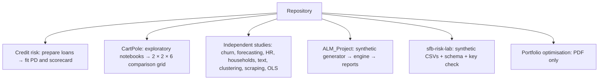
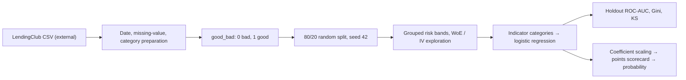
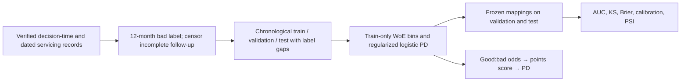
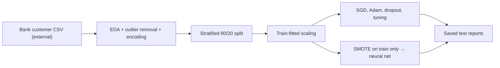

# Analytics & ML Portfolio — technical blueprint

This is a source-grounded guide to the repository as it exists. **“Implemented” means code is present; “saved output” means a notebook or report contains a prior result. Fresh runs are identified explicitly.** There is no shared pipeline spanning all projects. The two original credit-risk notebooks form a sequence, with a separate corrected reference; the CartPole notebooks form an experiment family. Other notebooks are independent studies. The [README](README.md) is the short navigation guide.

## 1. Portfolio architecture and evidence



| Evidence level | What it supports | What it does not establish |
| --- | --- | --- |
| Code and saved output | A method was written and a result was saved in the file. | Reproducibility today, independent validation, or production readiness. |
| Code without output | An intended implementation can be inspected. | That training, testing, or inference completed. |
| Narrative or PDF only | A documented idea or historical result. | An executable implementation in this repository. |

The inventory is 40 Jupyter notebooks, [ALM scripts](ALM_Project/src/alm_engine.py), a [synthetic bank lab](sfb-risk-lab/data/README.md), and one portfolio PDF. Input data are committed only for the small synthetic bank lab. Notebook outputs may be stale relative to current cell order; execution counts are cleared in several notebooks despite retained output.

## 2. Common foundations

For binary classification, a confusion matrix gives true positives (TP), false positives (FP), true negatives (TN), and false negatives (FN). Precision = TP/(TP+FP), recall = TP/(TP+FN), and F1 = 2·precision·recall/(precision+recall). For example, 75 true churners caught, 25 missed, and 75 false alarms give recall 0.75 and precision 0.50. Accuracy alone can conceal poor minority-class recall. ROC-AUC measures ranking over thresholds; calculate it from probabilities or scores, **not hard class labels**. A test set should be held back until all preprocessing, tuning, threshold selection, and model choice are complete.

Training-only transformations matter: fit scaling, encoding, text vocabulary, imputation, feature selection, and sampling using training folds only. Repeatedly comparing candidates on a test set makes it a de facto validation set. A train/validation/test or nested cross-validation design is a practical extension.

## 3. Credit-risk PD capstone

**Business objective.** Rank loan applications by default risk and translate a fitted score into an interpretable points scorecard. The project has two connected notebooks: [prepare data](<Capstone_NIBM_Credit Risk Modeling (PD Scorecard)/1_Data-Preparation.ipynb>) and [fit, validate, score](<Capstone_NIBM_Credit Risk Modeling (PD Scorecard)/2_PD Model & Scorecard.ipynb>). The first reads a local LendingClub `loan_data_2007_2014.csv`, creates features and CSV exports; the second reads those exports from a different author-specific Windows path. None of those CSVs are committed.



The raw notebook output shows **466,285 loans** and the modelling notebook loads **373,028 training** and **93,257 test** rows. The target marks `Charged Off`, `Default`, policy charged-off, and `Late (31-120 days)` as bad (0); other statuses become good (1). This is a chosen proxy, not a measured future default horizon. The preparation notebook explores grouped bins for grade, home ownership, geography, verification, purpose, term, employment length, issue-age, interest rate, income, DTI and delinquency fields, among others. It computes weight of evidence (WoE) and information value (IV):

```text
WoE_b = ln[(good_b / total_good) / (bad_b / total_bad)]
IV = Σ_b [(good_share_b - bad_share_b) × WoE_b]
```

Zero shares require smoothing. A positive WoE here means a greater share of **good** loans. The final design uses grouped indicator columns and reference categories, not a single WoE-transformed matrix. The logistic model has `logit(P(good|x)) = β₀ + Σ βⱼxⱼ`; therefore **PD = 1 − P(good|x)** under the notebook's target definition. A one-unit feature change changes log-odds by its coefficient, conditional on the other selected features.

The modelling notebook fits a full logistic model, then a reduced model using p-value inspection. It scales coefficients into score points, sets reference-category points to zero, rounds scores, manually adjusts one point, reconstructs probabilities, and tabulates approval cutoffs. Saved holdout results are **AUROC 0.688277**, **Gini 0.376554 = 2·AUC−1**, and **KS 0.279013**. A displayed threshold-specific accuracy is **0.565813**; it is not a chosen operating point. With predicted `P(good)`, high scores correspond to safer loans.

**Assumptions and limits.** The dataset and intermediate features are absent; local paths break fresh execution. Random splitting can mix loan vintages; an out-of-time test would better represent future underwriting. Candidate fields must be audited for availability at application time. Fine bins may be unstable; p-value selection is exploratory; no calibration, population stability, fairness, reject inference, or external validation is demonstrated. The saved scorecard table in modelling cell 91 contains `NaN` coefficients, and saved scored-loan outputs in cells 122–123 are `NaN`; the historical scoring demonstration is not a validated points-to-PD calculation. The scorecard is a learning artifact, not a deployable lending policy.

### Separate corrected scorecard reference (synthetic-tested)

The [corrected reference and reproduction guide](credit_risk_corrected/README.md) preserve both notebooks and require a canonical decision-time plus dated-servicing input. The original 75-column CSV does not supply a verified exact decision date or first 90+ DPD/charge-off event date, and it is absent locally; **no real-data PD was fitted**. The [strict contract](credit_risk_corrected/contract.py) uses a 12-calendar-month window, excludes censored loans, and places explicit label-observation gaps between training, validation and test vintages. Only six declared borrower/application fields can enter the model; their actual decision-time availability still requires source review.



The [model](credit_risk_corrected/model.py) smooths each train-bin good/bad count, computes `WoE_b = ln(P(b|good)/P(b|bad))` and `IV = Σ_b (P(b|good)−P(b|bad))×WoE_b`, then fits `logit(P(bad|x)) = β0 + Σ_j βj WoE_j(x)` with L2 regularization on slopes. With factor `20/ln(2)`, base score 600 and base good:bad odds 50:1, `score = 600 − factor × [logit(PD) + ln(50)]`. Higher scores mean lower PD; an exact component sum and inverse score check replace manual points adjustment. Calibration and PSI bins are fixed on training predictions. The [configuration](credit_risk_corrected/config.json) and [synthetic tests](credit_risk_corrected/test_pipeline.py) are reproducible with Python 3.10+ and no third-party packages. The default CLI refuses an input without a verified source name and SHA-256. These are software checks, not LendingClub performance metrics.

## 4. Forecasting antidiabetic prescriptions

The [forecast notebook](<Forecasting of Antidiabetic Drug Prescriptions.ipynb>) reads an Australian monthly antidiabetic prescription series through an external raw GitHub CSV URL. Saved data span **204 months (July 1991–June 2008)**. The first 168 observations are used for initial model selection; the last 36 form three 12-month forecast windows. STL decomposition shows trend and seasonality. ADF tests and residual plots guide a seasonal ARIMA choice.

The stated model is `SARIMA(2,1,3)(1,1,3)[12]`. In lag-operator notation, differencing is `(1−B)^d(1−B^12)^D y_t`; AR and MA terms model ordinary and seasonal lags and shocks. The notebook enumerates **5⁴ = 625** parameter tuples, fits statsmodels `SARIMAX` with no exogenous features, and sorts by AIC (`2k−2 log L`; lower is preferred for comparable fits). In rolling evaluation, it refits on observations available at each 12-month origin and compares the next-year forecast with `y[t−12]`.

| Saved holdout metric | Seasonal naive | Fitted SARIMA |
| --- | ---: | ---: |
| Mean absolute percentage error over 36 months | 12.6866% | 7.8988% |

`MAPE = (100/n) Σ |(y_t−ŷ_t)/y_t|`; it is undefined at zero and unstable near zero. Thus 7.90% is an average absolute percentage miss on these 36 saved observations, not a guaranteed future error.

**Audit notes.** The displayed sorted AIC table's first row is **(1,0,2,3), AIC 26.6187**, while the narrative selects **(2,3,1,3)** and the subsequent fitted model has AIC **276.234**. The ranking, fit convergence, and chosen specification need reconciliation. The seasonal-differencing cell calls `np.diff(y_diff, n=12)`, a **twelfth-order consecutive difference**, not a lag-12 seasonal difference; it does not directly justify `D=1`. The Ljung–Box narrative treats nonrejection as proof of independent residuals; it only means the test did not find enough evidence of serial correlation at the tested lags. Neither model runtime nor result was reproduced here.

### Corrected companion (newly executed, restricted model)

The separate [corrected notebook](<Forecasting of Antidiabetic Drug Prescriptions - Corrected.ipynb>) explains the [standard-library runner and data acquisition](forecasting/README.md). It leaves the original notebook and saved outputs intact. The runner was executed with Python 3.14.5 on the exact source CSV, verified by SHA-256; the CSV is not committed. It writes [individual predictions and metrics](forecasting/corrected_results.json) and a [forecast plot](forecasting/rolling_forecasts.svg). Notebook code cells were smoke-tested sequentially with Python, but no Jupyter kernel or saved notebook outputs were used.

Here seasonal differencing is explicitly `z[t] = y[t] - y[t-1] - y[t-12] + y[t-13]`, or `(1-B)(1-B^12)y[t]`. The first 168 months choose `p` from a predeclared `SARIMA(p,1,0)(0,1,0)[12]` family, `p=0,1,2`, with an intercept in the differenced equation. Conditional least squares fits each candidate on the same 153 transformed observations. The conditional Gaussian AIC, with the same omitted constant in each fit, selects `p=2` on training data alone; it is **not comparable numerically** with the original statsmodels exact-likelihood AIC. At origins 168, 180 and 192, the selected order is refitted using only observations then available and forecasts the next 12 months. Ordinary naive and seasonal naive predict the same 36 targets.

| Freshly calculated 36-month rolling holdout | MAE | RMSE | MAPE |
| --- | ---: | ---: | ---: |
| Ordinary naive | 3.178 | 4.148 | 14.545% |
| Seasonal naive | 2.658 | 3.154 | 12.687% |
| Restricted conditional SARIMA(2,1,0)(0,1,0)[12] | **1.795** | **2.156** | **8.869%** |

The corrected model has lower error on these three annual windows, but this is one short holdout on one series. It does not reproduce the original 625-model search or its 7.8988% saved MAPE; no confidence-interval coverage or prospective performance claim is established. Focused tests check lag-12 differencing, common AIC sample length, metric arithmetic and first-origin isolation from future values.

## 5. Bank churn prediction

The [churn notebook](BankChurnPrediction.ipynb) models `Exited` from a 10,000-row bank customer CSV loaded from an external/local path. It drops row ID, customer ID, and surname; removes IQR outliers from credit score and age (saved modelling sample **9,626**); encodes gender and geography; makes an 80/20 **stratified** split; and fits a standard scaler on training data. It compares dense Keras networks with SGD, Adam, dropout, grid-tuned settings, and a train-only SMOTE variant.



The baseline net minimizes binary cross-entropy `−[y log p + (1−y) log(1−p)]`. Its saved SGD test confusion matrix is `[[1486, 50], [204, 186]]`, with class 1 = churn: recall `186/(186+204) ≈ 0.48`, precision `186/(186+50) ≈ 0.79`, ROC-AUC **0.8533**. The SMOTE report states churn recall **0.75** and precision **0.51**. This demonstrates a decision tradeoff, not a proved model improvement: attach costs to missed churners and unnecessary outreach and choose a threshold on validation data.

Outlier removal and category encoding occur before splitting; the former uses full-data quantiles. More seriously, all networks use `X_test, y_test` as `validation_data` during training and the same set for model comparison, so the reported test metrics are no longer an untouched final evaluation. No temporal validation or calibration is shown. The input CSV is absent.

## 6. CartPole reinforcement learning

The [CartPole capstone folder](<Capstone_IISC_Reinforcement Learning - CartPole Optimization (IISc Capstone)>) is one **experiment family**, not 29 unrelated projects. [Baseline EDA](<Capstone_IISC_Reinforcement Learning - CartPole Optimization (IISc Capstone)/1.1 Base RL & EDA.ipynb>) and [reward trials](<Capstone_IISC_Reinforcement Learning - CartPole Optimization (IISc Capstone)/2.3 Final Custom Reward and its integration into algorithms.ipynb>) explore position/angle shaping, REINFORCE baselines, entropy, and PPO/DQN variants. [Weight tuning](<Capstone_IISC_Reinforcement Learning - CartPole Optimization (IISc Capstone)/2.4 REINFORCE_custom_rewards_weight_tuningnov28.ipynb>) extends the trials. Four directories contain paired v0/v1 and with/without custom-reward runs:

| Environment/reward | DQN | Policy gradient | Actor–critic | PPO | DDPG + twin-Q adaptation | SAC |
| --- | --- | --- | --- | --- | --- | --- |
| v0, custom | [notebook](<Capstone_IISC_Reinforcement Learning - CartPole Optimization (IISc Capstone)/v0_withCR/01-Basic DQN-with_cr.ipynb>) | [notebook](<Capstone_IISC_Reinforcement Learning - CartPole Optimization (IISc Capstone)/v0_withCR/02-policy-gradient.ipynb>) | [notebook](<Capstone_IISC_Reinforcement Learning - CartPole Optimization (IISc Capstone)/v0_withCR/03-actor-critic.ipynb>) | [notebook](<Capstone_IISC_Reinforcement Learning - CartPole Optimization (IISc Capstone)/v0_withCR/04-ppo.ipynb>) | [notebook](<Capstone_IISC_Reinforcement Learning - CartPole Optimization (IISc Capstone)/v0_withCR/05-ddpg_twinq.ipynb>) | [notebook](<Capstone_IISC_Reinforcement Learning - CartPole Optimization (IISc Capstone)/v0_withCR/06-sac.ipynb>) |
| v0, original | [notebook](<Capstone_IISC_Reinforcement Learning - CartPole Optimization (IISc Capstone)/v0_woCR/01-Basic DQN.ipynb>) | [notebook](<Capstone_IISC_Reinforcement Learning - CartPole Optimization (IISc Capstone)/v0_woCR/02-policy-gradient.ipynb>) | [notebook](<Capstone_IISC_Reinforcement Learning - CartPole Optimization (IISc Capstone)/v0_woCR/03-actor-critic.ipynb>) | [notebook](<Capstone_IISC_Reinforcement Learning - CartPole Optimization (IISc Capstone)/v0_woCR/04-ppo.ipynb>) | [notebook](<Capstone_IISC_Reinforcement Learning - CartPole Optimization (IISc Capstone)/v0_woCR/05-ddpg_twinq.ipynb>) | [notebook](<Capstone_IISC_Reinforcement Learning - CartPole Optimization (IISc Capstone)/v0_woCR/06-sac.ipynb>) |
| v1, custom | [notebook](<Capstone_IISC_Reinforcement Learning - CartPole Optimization (IISc Capstone)/v1_withCR/11-Basic DQN-with_cr-v1.ipynb>) | [notebook](<Capstone_IISC_Reinforcement Learning - CartPole Optimization (IISc Capstone)/v1_withCR/12-policy-gradient_custom.ipynb>) | [notebook](<Capstone_IISC_Reinforcement Learning - CartPole Optimization (IISc Capstone)/v1_withCR/13-actor-critic.ipynb>) | [notebook](<Capstone_IISC_Reinforcement Learning - CartPole Optimization (IISc Capstone)/v1_withCR/14-ppo.ipynb>) | [notebook](<Capstone_IISC_Reinforcement Learning - CartPole Optimization (IISc Capstone)/v1_withCR/15-ddpg-Custom.ipynb>) | [notebook](<Capstone_IISC_Reinforcement Learning - CartPole Optimization (IISc Capstone)/v1_withCR/16-sacwith_cr.ipynb>) |
| v1, original | [notebook](<Capstone_IISC_Reinforcement Learning - CartPole Optimization (IISc Capstone)/v1_woCR/11-Basic DQN-v1.ipynb>) | [notebook](<Capstone_IISC_Reinforcement Learning - CartPole Optimization (IISc Capstone)/v1_woCR/12-policy-gradient.ipynb>) | [notebook](<Capstone_IISC_Reinforcement Learning - CartPole Optimization (IISc Capstone)/v1_woCR/13-actor-critic_wo_custom_rewards.ipynb>) | [notebook](<Capstone_IISC_Reinforcement Learning - CartPole Optimization (IISc Capstone)/v1_woCR/14-ppo.ipynb>) | [notebook](<Capstone_IISC_Reinforcement Learning - CartPole Optimization (IISc Capstone)/v1_woCR/15-ddpg.ipynb>) | [notebook](<Capstone_IISC_Reinforcement Learning - CartPole Optimization (IISc Capstone)/v1_woCR/16-sac_wo_crr.ipynb>) |

CartPole has a four-element observation `(cart position, cart velocity, pole angle, angular velocity)` and two discrete actions. In representative custom-reward notebooks, the training reward combines exponential position and angle terms, approximately `r' = w[exp((x_max−x)/x_max)−0.999] + (1−w)[exp((θ_max−θ)/θ_max)−0.999]`. The code uses signed `x` and `θ`; without absolute values this is **asymmetric** around zero. Episode test scores are still accumulated from the environment's original reward. v0 caps at 200 steps, v1 at 500; scores across versions are not directly comparable.

DQN learns an action-value estimate using a bootstrapped Bellman target `r+γ max_a Q_target(s',a)`; policy gradient optimizes expected discounted return; actor–critic learns a value baseline; PPO clips policy probability ratios; SAC adds entropy regularization. The DDPG notebooks adapt continuous actor output to CartPole's discrete actions through thresholding, so their behaviour is not a standard continuous-action DDPG benchmark. Twin-Q uses the minimum of two target value estimates.

Saved outputs show individual successes and failures, including a [v0 PPO custom run](<Capstone_IISC_Reinforcement Learning - CartPole Optimization (IISc Capstone)/v0_withCR/04-ppo.ipynb>) reporting a 200-step training episode at 139 versus [original reward](<Capstone_IISC_Reinforcement Learning - CartPole Optimization (IISc Capstone)/v0_woCR/04-ppo.ipynb>) at 165. These are **single-run observations**, not evidence that reward shaping reliably improves PPO. Several cells call legacy Gym `env.seed` / `env.reset` signatures and mix four- and five-value `step` unpacking. A reproducible comparison needs pinned Gym/PyTorch versions, multiple paired random seeds, common evaluation episodes, confidence intervals, and explicit success criteria.

## 7. Employee retention and performance

The [HR notebook](<Employee Retention & Performance Analytics.ipynb>) reads a Salfort HR CSV from a Colab path, performs EDA and one-hot encoding, and compares logistic regression with tuned decision trees and random forests. It repeats the tree/forest study after feature engineering and feature removal, so results from the two feature sets should be read separately. Trees reduce class impurity; forests average many bootstrapped trees to lower variance. Four-fold grid search selects by `roc_auc` on a train subset, with separate validation and test partitions.

Saved logistic output has **0.82 test accuracy** but only **0.26 recall** for employees who left. The later random-forest feature-set variant reports **0.894 test F1** and **0.965 test accuracy**. These outputs are useful for discussing minority-class performance; they are not causal evidence about why employees leave. The helper named `get_scores` computes its displayed “AUC” from `predict` hard labels rather than `predict_proba`, so those AUC numbers should not be quoted as ranking ROC-AUC. The CSV is absent, and repeated model/feature-set choices use the same test set.

## 8. Household rural/urban classification

The [household notebook](Socio_Economic_Household_Classification.ipynb) reads an external Colab Drive survey CSV. Saved output begins with **176,661 rows / 38 columns**; after cleaning, feature engineering, and target filtering it models **118,885 rows / 28 features**, with a stratified 95,108/23,777 train/test split. It engineers investment income, a top-decile income flag, household size, dependency ratio, and transfer/rental-income flags. Training-fitted scaling and one-hot encoding feed logistic, tree, ANN, forest and XGBoost variants; later cells try SMOTE, class weighting, PCA and soft voting.

Saved outputs include tuned random-forest **0.8356 test accuracy** with rural recall **0.61** and a later weighted XGBoost **0.8405 test accuracy** with rural recall **0.63**. SMOTE raises rural recall relative to an earlier XGBoost variant but lowers overall accuracy. The notebook reports **57 failed fits out of 150** during one forest search; selection from that search needs investigation. The top-decile income threshold and other engineered decisions are made on the full dataset before splitting, and feature selection plus repeated test comparisons may bias reported performance. Rural/urban labels are a survey category; any policy interpretation needs sampling, geography, fairness and construct-validity review.

## 9. Text and descriptive analysis

| Study | Pipeline and saved evidence | Limits |
| --- | --- | --- |
| [Airline tweet sentiment](<Twitter Sentiment Analysis with NLP.ipynb>) | External 14,640-row airline-tweet CSV; text cleaning, count/TF-IDF vectors, random forest, five-fold train CV. Count-vector saved CV accuracy **0.7551** and test accuracy **0.77**; TF-IDF saved CV accuracy **0.7538** and test accuracy **0.75**. | Both vectorizers are fitted before the train/test split; tree count is explored against the test set. Refit vocabulary inside CV folds. |
| [COVID-19 tweet sentiment draft](<1_OTHER PROJECTS/Multiclass_classification_model_to_predict_the_sentiment_of_Covid_19_tweets.ipynb>) | Code for five-class BERT tokenization, trainer, validation, and Kaggle test predictions. | **No executed cells or saved outputs**; dataset and Kaggle credentials are external. No verified model result. |
| [Social media vs stress](1_OTHER%20PROJECTS/SocialMediavsStress.ipynb) | Two external 99-observation CSVs; Pearson/Spearman correlation and OLS with gender interaction for PSS and GAD-7. Saved simple-model R²: **0.148** PSS, **0.244** GAD-7. | Cross-sectional associations, small sample, unknown sampling; no causal claim. OLS needs linearity, independent errors, stable variance and residual review. |
| [Mall segmentation](<1_OTHER PROJECTS/102_Customer Segmentation_K-Means Clustering.ipynb>) | External 200-customer mall CSV; income and spending score, elbow WCSS, five-cluster K-means. Objective: `Σᵢ ||xᵢ−μ_cluster(i)||²`. | The notebook computes scaled data but fits on unscaled `X`; Euclidean distances depend on units, and five clusters are heuristic. |
| [IMDb scraping](<1_OTHER PROJECTS/IMDb Movie Data – Web Scraping & Analysis.ipynb>) | Requests + BeautifulSoup scrape followed by cleaning and descriptive plots; saved output displays 1,000 films. | Live site content/markup can change; missing Metascore and Gross values appear. No predictive model. |

For OLS, `y = β₀ + β₁x + β₂g + β₃xg + ε` means `β₃` is the estimated difference in the `x` slope between coded gender groups, conditional on the model. Correlation and R² describe association and fit within the sample; they do not establish mechanism.

## 10. Synthetic banking prototypes and portfolio PDF

The [ALM generator](ALM_Project/src/data_generator.py) creates **500 synthetic assets** and **1,000 synthetic liabilities** with a fixed NumPy seed and base date 2025-06-07. The [engine](ALM_Project/src/alm_engine.py) validates amount/rate non-nullness, buckets repricing dates, computes `gap = assets−liabilities`, applies a +100 bp shock to floating-rate instruments, and calculates a simplified `LCR = haircut-adjusted HQLA / modelled 30-day outflows × 100`. Committed [NII](ALM_Project/reports/nii_sensitivity_report.txt) and [LCR](ALM_Project/reports/lcr_summary_report.txt) examples show **−₹3.58 crore** and **724.97%**, respectively. These are simulated report outputs; the raw generated asset/liability CSVs are not committed. The NII calculation applies a full-year rate change without repricing timing, and the LCR omits several real regulatory components (such as inflows and HQLA caps). Read [ALM project notes](ALM_Project/README.md) as proof-of-concept context.

The [small-finance-bank lab](sfb-risk-lab/data/README.md) contains a [schema](sfb-risk-lab/data/schema.yaml), three tiny synthetic CSV tables, and a [quick key check](sfb-risk-lab/notebooks/00_quickpeek.py). It checks unique customer/loan IDs and referential membership; there is no risk score, training, or evaluation pipeline. The [MPT PDF](<1_OTHER PROJECTS/104_Portfolio Optimization_MPT.pdf>) is a standalone document. No portfolio-optimization code, NIFTY price dataset, or reproducible performance series is in this repository, so its numerical claims should be read as document claims only.

## 11. Reproducibility and setup

1. Clone the repository and open the relevant notebook in Jupyter, or read its saved outputs on GitHub.
2. Obtain the source dataset through the notebook's cited source and review its licence and schema. Replace author-specific Windows and Colab paths; do not assume the notebook will download it.
3. Create an isolated Python environment and install only the imports used by that notebook. There is **no root pinned requirements file**. The [bank lab requirements](sfb-risk-lab/requirements.txt) and [ALM setup](ALM_Project/README.md) apply only to their folders.
4. Before a fresh run, inspect cells for network fetches, pip commands, output file writes, expensive searches, and legacy API calls. Run from a clean kernel in sequence and log package versions and random seeds.
5. Rebuild a train-only pipeline, keep a final holdout untouched, and compare freshly calculated outputs with saved outputs. Report any deviations rather than silently replacing historical results.

No notebooks, external data downloads, dependency installations, or modelling jobs were run for this documentation audit. The saved outputs confirm historical notebook state only. The highest-value extensions are a reproducible credit-risk data contract and out-of-time validation; a corrected forecasting stationarity/model-selection audit; a clean churn validation split; and a multi-seed CartPole benchmark.
