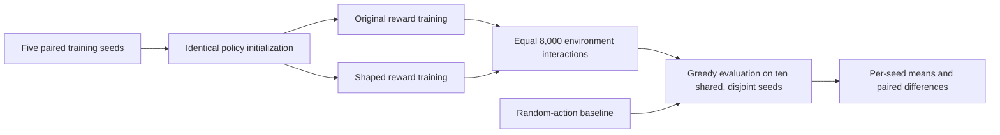

# CartPole: a paired reward-shaping study

This is a separate, controlled **REINFORCE-style policy-gradient** comparison inspired by the historical [custom-reward](<../Capstone_IISC_Reinforcement Learning - CartPole Optimization (IISc Capstone)/v0_withCR/02-policy-gradient.ipynb>) and [original-reward](<../Capstone_IISC_Reinforcement Learning - CartPole Optimization (IISc Capstone)/v0_woCR/02-policy-gradient.ipynb>) notebooks. All 29 original CartPole notebooks and their saved outputs remain unchanged. The new [configuration](config.json), [runner](experiment.py), [tests](test_experiment.py) and [raw results](results.json) are independent of their interactive state. **The new numbers below were actually run; historical saved scores are not copied into them.**

## Problem and historical context

CartPole observes `(cart position, cart velocity, pole angle, angular velocity)` and chooses left/right force. Each original environment reward is +1 per surviving step. The historical family contains five exploratory notebooks (EDA, initial reward/grid trials, baseline/entropy work, algorithm integration, and reward-weight tuning) plus 24 algorithm notebooks: v0/v1 × original/custom training reward × six algorithm families. Those families are DQN, REINFORCE/policy gradient, actor–critic, PPO-labelled, a thresholded continuous-actor DDPG/twin-Q adaptation, and SAC. The [technical blueprint](../PROJECT_BLUEPRINT.md#6-cartpole-reinforcement-learning) maps the 24 individual files.

The 24 notebooks use different 200/500-step caps, training budgets, stop rules and sometimes stochastic versus greedy tests. Most have a single apparent training seed, and evaluation initial-state seeds overlap training episode seeds. The paired PPO-labelled notebooks use an unclipped probability ratio plus KL penalty; the exploratory 2.3 notebook contains a distinct clipped PPO implementation. The DDPG/twin-Q CartPole adaptation thresholds a continuous actor into discrete actions. Those distinctions prevent a meaningful league table across all six labels. The paired custom rewards use **absolute** cart position and pole angle: they are symmetric in left/right direction, correcting an earlier portfolio description. The five exploratory notebooks contain other reward definitions and are historical design work, not equivalent replicates.

## Selected comparison and mathematics

We compare **one algorithm** under two training rewards. Both policies use the same 4→128→2 ReLU network, AdamW learning rate 0.001, discount factor `γ=0.99`, stochastic training actions and the same training step budget. They share initialization and training initial-state seeds within each paired seed. One learns from the environment's +1 reward. The other uses the exact form of the historical v0 policy-gradient pair's custom reward after each transition:

`r_shape(s') = 0.15[exp((x_max−|x'|)/x_max)−0.999] + 0.85[exp((θ_max−|θ'|)/θ_max)−0.999]`,

where `x_max` is the observation-space cart bound (4.8) and `θ_max` is half the observation-space angle bound minus 0.001 (about 0.2084 radians). For example, flipping both signs of `x'` and `θ'` leaves this reward unchanged. It can reward a short, centered trajectory differently from a longer trajectory. It is **not shown to be potential-based** of the form `γΦ(s')−Φ(s)`, so it need not preserve the environment's optimal policy. Its scale also differs from +1; any effect combines shape and magnitude.

REINFORCE samples `a_t ~ π_θ(.|s_t)` during training. Its discounted return is `G_t = Σ_{k=t}^{T−1} γ^{k−t} r_k`, and the implementation minimizes `L(θ)=−mean_t[G_t log π_θ(a_t|s_t)]` after each episode, with gradient clipping. Stochastic sampling explores; greedy `argmax_a π_θ(a|s)` evaluation uses no exploration and never updates policy parameters. The corrected update is intentionally simpler than the historical interactive notebook; this is a new controlled comparison, **not a byte-for-byte reproduction** of its training trajectory.



Gymnasium **1.1.1** runs `CartPole-v1` with an explicit **200-step** time limit, giving one consistent environment and the v0-length cap. This is a modern-API study, not a claim that legacy Gym v0 produced identical trajectories. Each condition gets exactly 8,000 training transitions for each of five seeds; an episode may be cut at the budget. Evaluations occur at 0, 2,000, 4,000, 6,000 and 8,000 interactions. The last checkpoint is re-evaluated after the final episode update; earlier checkpoints use the policy when the interaction count is reached. Evaluation episodes use the environment's **original +1 reward** only, ten fixed seeds in a disjoint range, and the same greedy policy rule for both conditions. The random-action baseline uses those same initial-state seeds and five independent action streams. Evaluation transitions do not count toward the training budget.

## Newly executed results

The table uses **one mean evaluation score per training seed** (ten episodes each); it then reports the mean and sample SD across five seeds. The maximum score is 200. These are [saved real-environment runs](results.json), not historical notebook values.

| Training interactions | Original training reward | Shaped training reward |
| ---: | ---: | ---: |
| 0 | 9.46 ± 0.47 | 9.46 ± 0.47 |
| 2,000 | 45.80 ± 17.23 | 46.94 ± 23.41 |
| 4,000 | 55.04 ± 17.41 | 60.38 ± 29.68 |
| 6,000 | 64.02 ± 13.67 | 89.68 ± 49.02 |
| 8,000 | **85.56 ± 40.77** | **97.48 ± 44.27** |

The random-action baseline averaged **25.94 ± 4.55** across five action streams. At 8,000 interactions, the shaped-minus-original paired mean is **+11.92**, with **SD 36.66** across training seeds. Individual paired differences are `+30.0, −35.0, −12.7, +58.8, +18.5`; two of five seeds favor original-reward training. The experiment shows learning above the random baseline for these settings, and substantial seed variability. It **does not establish a reliable shaping advantage** or that either approach solves the 200-step task. In particular, saved historical near-ceiling scores from much longer or differently stopped runs should not be compared as if they shared this budget.

## Reproduce and inspect

Use Python 3.14 and the pinned [requirements](requirements.txt). PyTorch is the largest dependency. The run used Windows CPU with Python 3.14.5, Gymnasium 1.1.1, NumPy 2.5.4 and PyTorch 2.13.0+cpu; Gymnasium was installed in a local ignored directory, and no dependency files were committed. In a clean environment from the repository root:

```powershell
python -m pip install -r cartpole_corrected/requirements.txt
python -m unittest cartpole_corrected.test_experiment -v
python -m cartpole_corrected.experiment --config cartpole_corrected/config.json --output cartpole_corrected/local-results.json
```

Compare the local JSON with [`results.json`](results.json): its config, library versions, per-seed checkpoint scores and aggregate summaries are explicit. A rerun can differ across hardware or library builds even with fixed seeds; preserve the local output and report deviations. The seven focused tests cover reward symmetry/formula, discounted returns, disjoint seeds, original-reward evaluation, no evaluation RNG draw, equal interaction budgets/checkpoints, and per-seed aggregation. A separate read-only check recomputed every saved per-seed mean, cross-seed SD and paired difference from the raw episode scores. No hyperparameter search or historical notebook execution was performed.

## Limits and interview-safe interpretation

Five training seeds and ten evaluation episodes per seed give a useful variance check, not a precise population estimate. Fixed evaluation initial states make paired comparisons less noisy, but do not cover all possible starts. Reward magnitude and shape are confounded. The fixed 8,000-step budget is deliberately small and far below historical notebooks' varying 200/500-step episode budgets. One environment, one policy class and one hyperparameter setting do not rank all six historical algorithm families. No statistical significance or generalization to other control problems is claimed. The case study's strongest professional evidence is the experimental redesign: equal interactions, clear reward separation, disjoint evaluation seeds, original-reward measurement and honest seed-level variability.
