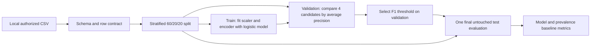

# Bank churn: corrected reference analysis

This is a **tested modelling framework**, not a reproduced result on bank customers or a validated retention model. The [original notebook](../BankChurnPrediction.ipynb) and its saved outputs are preserved as historical experiments. The corrected code uses a small, auditable logistic-regression comparison instead of rerunning five neural nets.

## Data and prediction contract

The original notebook calls KaggleHub with [`mathchi/churn-for-bank-customers`](https://www.kaggle.com/datasets/mathchi/churn-for-bank-customers) and reads `churn.csv`. No exact source snapshot or CSV is in this repository. Its license, version and ability to reuse it were not verified here; no data was downloaded or committed. To reproduce on real data, obtain an authorized copy of the **same** 14-column CSV, record its source/version and rights, and pass its local path to the runner. The runner records its SHA-256 hash. A different churn dataset is a new study, not a reproduction of the historical notebook.

| Role | Required columns |
| --- | --- |
| Target | `Exited` (0 = retained, 1 = exited) |
| Numeric candidate inputs | `CreditScore`, `Age`, `Tenure`, `Balance`, `NumOfProducts`, `HasCrCard`, `IsActiveMember`, `EstimatedSalary` |
| Categorical candidate inputs | `Geography`, `Gender` |
| Excluded identifiers | `RowNumber`, `CustomerId`, `Surname` |

The CSV reader requires exactly these columns, finite numeric fields, binary flags and target, and nonempty category fields. It rejects missing values. The available schema has no observation date, exit date or prediction horizon. **Application-time availability of balance, product count and activity is unverified**; using them for a prospective offer requires a time-stamped feature snapshot before exit. Neither the label nor an identifier enters the model.

## Design



Splitting precedes every learned transform. The scaler's means and variances and one-hot category set are fitted on training rows inside each candidate's `Pipeline`; unknown validation/test categories are ignored. There is no full-data outlier deletion. The four prespecified logistic candidates use `C ∈ {0.1, 1}` and either no class weighting or `class_weight="balanced"`. The best validation **average precision** wins; validation Brier score breaks ties. No test score controls model or threshold choice. The threshold is the best validation F1 over 0.10–0.90 in steps of 0.05, with higher threshold winning exact ties. This is an illustrative error tradeoff: an actual retention program should choose a threshold from outreach cost, intervention benefit, capacity and calibration.

Ordinary SMOTE is **not** used: linear interpolation after one-hot encoding can create fractional categories, and a simple class-weight/threshold comparison answers the immediate imbalance question with less complexity. If a categorical-aware sampler is later justified, it must fit inside each training fold. No cross-validation is used in this reference; one fixed validation partition chooses among only four candidates. The test set is consumed once after selection.

The baseline predicts the **training prevalence** as a constant probability and uses a 0.5 decision threshold (the majority-class decision for this imbalanced dataset). It shares the same test rows. Reported `pr_auc_average_precision` is average precision, the stepwise precision–recall area, not trapezoidal PR area. Confusion entries are `[TN, FP, FN, TP]`. The test report also includes ROC-AUC, precision, recall, F1, Brier score and five fixed probability-bin observed rates. Calibration is descriptive; no recalibration is fitted. Class weighting can harm probability calibration even when ranking improves.

## Reproduce

With Python 3.11+ and locally installed NumPy and scikit-learn (focused checks used Python 3.14, NumPy 2.5.1 and scikit-learn 1.9.0):

```powershell
python -m unittest churn_corrected.test_pipeline -v
python -m churn_corrected.pipeline --csv path/to/authorized/churn.csv > local-churn-results.json
```

Run from the repository root. A [requirements file](requirements.txt) pins the two runtime packages to the versions used for the focused tests; installing them is optional and was not done for this phase. The output JSON is local evidence for the exact input hash and environment; **do not commit the CSV, generated predictions or private customer data**. The repository's `.gitignore` excludes CSV files. The tests create only explicitly synthetic in-memory rows and temporary records; passing them does not establish real-world performance.

## Historical lesson and limits

The original notebook filters outliers using full-data quantiles and encodes categories before splitting; its later grid search uses scaling fitted before its internal CV folds. Its direct Keras fits use the test partition as `validation_data` and compare several variants on it. Ordinary SMOTE is confined to the training partition, but applied to already scaled one-hot features. Its saved SGD ROC-AUC 0.8533 and SMOTE ROC-AUC 0.8515, and the corresponding precision/recall reports, are **historical saved outputs**, not independently reproduced model comparisons. See the [blueprint](../PROJECT_BLUEPRINT.md#5-bank-churn-prediction).

This pipeline remains a framework until an authorized, versioned source is available. A credible prospective churn claim would additionally require observation and exit dates, time-aware splits, feature availability evidence, calibration and segment stability checks, and intervention costs. The raw `Exited` field alone does not define a future prediction window.
